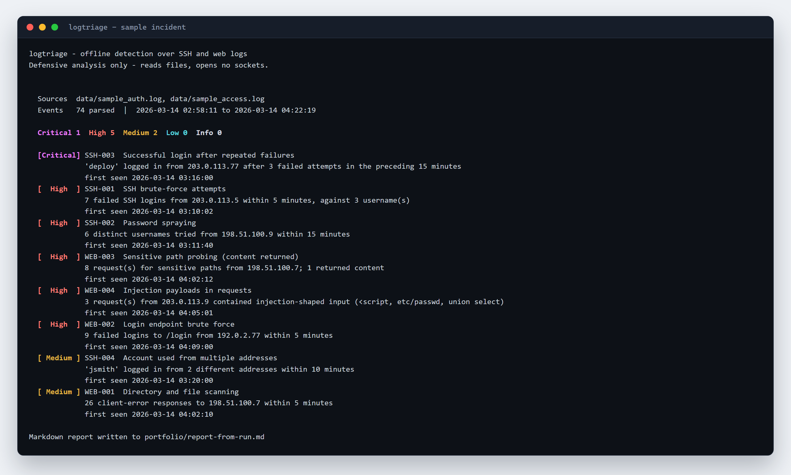

# logtriage

Offline triage for SSH auth logs and web access logs. It normalises both formats, runs a fixed set of
detection rules, and produces an incident summary an analyst could hand to a shift lead: severity
counts, a timeline, and each alert with the log lines that triggered it.



No network access, no dependencies, no log shipping — you point it at files.

```
$ python -m logtriage data/sample_auth.log data/sample_access.log --year 2026

  Critical 1  High 5  Medium 2  Low 0  Info 0

  [Critical] SSH-003  Successful login after repeated failures
             'deploy' logged in from 203.0.113.77 after 3 failed attempts in the preceding 15 minutes
  [  High  ] SSH-001  SSH brute-force attempts
             7 failed SSH logins from 203.0.113.5 within 5 minutes, against 3 username(s)
  [ Medium ] WEB-001  Directory and file scanning
             26 client-error responses to 198.51.100.7 within 5 minutes
```

## What it detects

| Rule | Detects | Severity | ATT&CK |
| --- | --- | --- | --- |
| `SSH-001` | Brute force — many failures from one source in a short window | High | T1110.001 |
| `SSH-002` | Password spraying — many usernames, few attempts each | High | T1110.003 |
| `SSH-003` | A successful login following repeated failures | **Critical** | T1078 |
| `SSH-004` | One account used from several addresses minutes apart | Medium | T1078 |
| `WEB-001` | Directory/file scanning — a burst of client errors | Medium | T1595 |
| `WEB-002` | Login endpoint brute force — repeated 401/403 on a login path | High | T1110.001 |
| `WEB-003` | Sensitive path probing (`.git`, `.env`, `server-status`, …) | High if content returned | T1083 |
| `WEB-004` | Injection-shaped input in the request path or query | High | T1190 |

Each alert carries the raw log lines that triggered it, the entities involved, and a concrete next
step. Nothing is inferred that the log does not show.

## Quick start

Requires Python 3.9+. No third-party packages.

```bash
git clone https://github.com/biggjayy2000/logtriage.git
cd logtriage

# Triage the shipped sample logs
python -m logtriage data/sample_auth.log data/sample_access.log --year 2026

# Write an incident report
python -m logtriage data/sample_auth.log data/sample_access.log --year 2026 \
  --markdown incident.md --json incident.json

# Tests
python -m unittest discover -s tests -t . -v
```

## Usage

```
python -m logtriage LOG [LOG ...] [options]

  --markdown PATH     write a Markdown incident report
  --json PATH         write a JSON incident report
  --allowlist IP      ignore this source address (repeatable)
  --year YYYY         year for syslog lines, which omit it (default: current year)
  --no-color          plain output
  --quiet             summary only
  --fail-on LEVEL     exit 1 at or above this severity (default High, or 'never')
```

`LOG` accepts files or directories; a directory is read file-by-file. Exit codes: `0` clean for the
chosen threshold, `1` alerts at or above it, `2` nothing readable.

## Supported formats

- **OpenSSH `auth.log`** (syslog): `Failed password`, `Failed publickey`, `Invalid user`,
  `Accepted password`, `Accepted publickey`.
- **Apache / Nginx `combined` access log**: IP, timestamp, request, status, user agent.

The format is detected per line, so mixed logs work in a single run. Lines that match neither format
are counted and reported as *unparsed* rather than silently dropped — a detection tool that hides its
blind spots is worse than none.

## Design notes

- **Thresholds live in `settings.py`**, not scattered through rules, so tuning noise is one edit.
  The values are deliberately conservative and documented in the report.
- **Rules are pure functions**: `(events, settings) -> list[Alert]`. Each has a test that proves it
  fires *and* a test that proves it stays quiet on normal traffic.
- **Windows are sliding, not bucketed.** Five failures at 10:05:59 and five at 10:06:01 must not look
  like two quiet minutes; `best_window` scans every window rather than grouping by minute.
- **IPs are allowlisted, not hidden.** `--allowlist` suppresses alerts from known scanners so a
  pentest or a monitoring probe doesn't drown the report.
- **Timestamps come from the log.** Mixing sources is normal, so web timestamps are normalised to UTC.

## Limitations

- **Threshold-based, not behavioural.** No baselining per user or per host, so a slow campaign under
  the threshold is invisible.
- **No geolocation.** `SSH-004` reports multiple addresses rather than an impossible-travel distance,
  because the tool ships no IP-to-country database and guessing would be worse than not claiming.
- **Single-file scope.** It triages what you give it; it does not tail, ship, or correlate across hosts.
- **SSH log year is a guess.** Syslog omits it, so `--year` is required for logs from a past year.
- **No state.** Running it twice gives the same answer; it cannot say "this is new since yesterday".

## Sample output

- [`examples/sample-report.md`](examples/sample-report.md) — incident report over the sample logs
- [`examples/sample-report.json`](examples/sample-report.json) — same data for tooling

## License

MIT.
